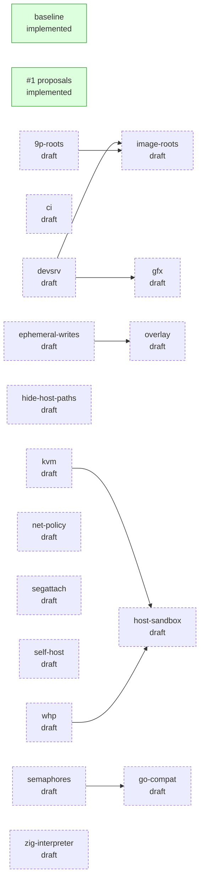

# h9 - Hyper9

Run native Plan 9 (9front) executables directly on host hypervisors. See [DESIGN.md](DESIGN.md).

## Status

h9 is under active development and isn't ready for general use yet. Work is
planned as proposals under [design/](design/README.md), each with its status
and the proposals it depends on; the [baseline](design/0000-baseline.md) is
what's built so far. `zig build design -- ready` lists what can be started now.

<!-- design:begin (zig build design -- readme) -->

| Proposal | Status | State | Title |
| --- | --- | --- | --- |
| [baseline](design/0000-baseline.md) | implemented |  | Baseline (h9 before proposals) |
| [proposals](design/0001-proposals.md) | implemented |  | Proposals replace milestones and the design changelog |
| [9p-roots](design/9p-roots.md) | draft |  | 9P roots |
| [ci](design/ci.md) | draft |  | Continuous integration |
| [devsrv](design/devsrv.md) | draft |  | devsrv and /srv |
| [ephemeral-writes](design/ephemeral-writes.md) | draft |  | Ephemeral writes and a private /tmp |
| [gfx](design/gfx.md) | draft | needs devsrv | Graphics (--gfx) |
| [go-compat](design/go-compat.md) | draft | needs semaphores | Go compatibility |
| [hide-host-paths](design/hide-host-paths.md) | draft |  | Hide host paths in /proc/n/ns |
| [host-sandbox](design/host-sandbox.md) | draft | needs kvm, whp | Host self-sandboxing |
| [image-roots](design/image-roots.md) | draft | needs devsrv, 9p-roots | Disk-image roots |
| [kvm](design/kvm.md) | draft |  | KVM backend |
| [net-policy](design/net-policy.md) | draft |  | Outbound-only network by default, and --net-allow |
| [overlay](design/overlay.md) | draft | needs ephemeral-writes | Copy-on-write overlay as the root's default |
| [segattach](design/segattach.md) | draft |  | segattach and shared segments |
| [self-host](design/self-host.md) | draft |  | Self-hosting |
| [semaphores](design/semaphores.md) | draft |  | rendezvous and semaphores |
| [whp](design/whp.md) | draft |  | WHP backend |
| [zig-interpreter](design/zig-interpreter.md) | draft |  | A native Zig interpreter for the emulator |



<!-- design:end -->

## Setup (macOS arm64)

Requires Zig 0.16.x and Xcode (for the macOS SDK and `codesign`).

```sh
. scripts/env.sh               # Zig cache and tools live in .local/ (gitignored); puts zig-out/bin (h9) on PATH
./scripts/fetch.sh             # reference sources (9front at the pinned release), 9front arm64 image, prebuilt and patched-source Unicorn into .local/
./scripts/mkroot.py            # extracts the 9front root tree into .local/9front/root (~1 min, ~250 MB)
```

`mkroot.py` boots the pinned image headless in QEMU (`brew install qemu`),
tars the file system out onto a scratch disk, and unpacks it into
`.local/9front/root-<release>`, with `.local/9front/root` linked to it. The
image itself isn't modified. It's the host-tree root h9 serves as `/`.
Boot kernels, `/sys/doc` and `/sys/src` are left out; pass `--src` to keep
`/sys/src`, which [self-hosting](design/self-host.md) needs.

Pinned upstream versions are in [scripts/pins.sh](scripts/pins.sh).

drawterm is committed under `third_party/drawterm` as a squashed git subtree,
so a fresh checkout builds without network access. To move to a new upstream
revision, bump `DRAWTERM_REV` and run `./scripts/vendor-drawterm.sh` on a
clean tree; it merges upstream into the subtree and keeps our local changes.

## Build

```sh
zig build          # builds and ad-hoc signs zig-out/bin/h9 with h9.entitlements
zig build test     # unit tests, and the backend tests on every backend built in
zig build kern     # compiles drawterm's kern and the libraries it uses
zig build integration  # real 9front binaries from the root tree through the h9 CLI
zig build proposal -Dp=baseline  # one proposal's demos and integration cases (by slug or id)
zig build design -- check        # validate design/ and the test tags (also list, ready, graph, new, file)
zig build clean    # removes zig-out and .zig-cache (not the fetched .local tree)
```

The demos and the integration tests use the root tree from
`scripts/mkroot.py`, or `-Droot=DIR`. Without a tree, the integration tests
skip and only the hello demos run. Each case is tagged with the proposal it
proves (`test "echo [baseline]"`); cases for a proposal that isn't implemented
yet skip in `zig build integration` and `zig build test` unless `-Dpending` is
given, and `zig build proposal -Dp=<slug or id>` runs one proposal's cases
whatever its status.
Interactive cases run h9 on a terminal the test creates
([tests/term.zig](tests/term.zig): a pty, or ConPTY on Windows), so they need
no human and no `ssh -t`.

The emulator backend links the prebuilt Unicorn (GPLv2) fetched by
`scripts/fetch.sh`, so it's opt-in and never part of the MIT `h9` build. It
ships separately as `h9-emu` (see [Releases](#releases)):

```sh
zig build -Demu=unicorn                              # macOS arm64
zig build -Demu=unicorn -Dtarget=aarch64-linux-musl  # Linux arm64 (also x86_64-linux-musl)
zig build proposal -Dp=baseline -Demu=unicorn        # the baseline demos, adding h9 --backend emu ./hello
zig build bench -Demu=unicorn                        # compute and syscall speed, emu vs the hypervisor
```

`-Dunicorn=source` builds Unicorn from the patched source instead
([third_party/unicorn](third_party/unicorn/README.md)); `scripts/fetch.sh`
fetches it. The prebuilt libraries exist for macOS arm64 and Linux musl only,
so Windows arm64 (`-Dtarget=aarch64-windows`) always builds from source. kern
builds for Windows with drawterm's win32 files, so h9.exe runs programs on
the emulator, and host paths are `/C:/...` in `#U`.

## Releases

Each GitHub release has two sets of binaries, built by
`scripts/release.sh [version]` into `dist/<version>/` from a clean checkout:

| Asset | License | Contents |
| --- | --- | --- |
| `h9-<version>-<target>` | MIT | `h9` with the hypervisor backends only (macOS arm64 for now) |
| `h9-emu-<version>-<target>` | GPLv2 | `h9-emu`: h9 built with `-Demu=unicorn`, for macOS arm64, Linux arm64 and x86_64 (musl, static) and Windows arm64 |
| `h9-emu-<version>-source.tar.gz` | GPLv2 and MIT | complete corresponding source for `h9-emu`: the h9 tree plus Unicorn's patched source in `.local/src/unicorn` |
| `SHA256SUMS` | | checksums |

`h9-emu` takes the same flags as `h9` and runs on hosts without a usable
hypervisor. It links Unicorn Engine, so the binary as a whole is GPLv2, with
`COPYING`, `NOTICE` and the MIT notices in each archive; see [LICENSE](LICENSE).
The script builds every binary from the unpacked source tarball, with Unicorn
from source (`-Dunicorn=source`), so the tarball is exactly what was built. It
needs `scripts/fetch.sh` to have been run and runs on macOS, which
cross-compiles the other targets.

## Run

```sh
zig-out/bin/h9 [h9-flags] [--] program [args...]
zig-out/bin/h9 [h9-flags] --rc 'command' [args...]
zig-out/bin/h9 --version                  # version, pinned 9front and drawterm, backends built in
zig-out/bin/h9 [--backend B] [--root DIR] --check
zig-out/bin/h9 --help                     # or -h alone

zig-out/bin/h9 /bin/cat /lib/namespace    # a baseline demo
zig-out/bin/h9 ls -l /bin/cat             # bare names search $path: . and /bin
zig-out/bin/h9 ./hello                    # ./ and ../ are host paths
```

A program starting with `./` or `../` is read from the host. Anything else is
a guest path or name in the machine's namespace: `/` is the root tree
(`--root`, else `$H9ROOT`, else `.local/9front/root` next to a development
build), `/bin` is `/arm64/bin` plus `/rc/bin`, and the host cwd (or `--cwd`)
is at `/mnt/term/cwd` and is the guest's cwd. The host environment isn't
imported: the guest gets `user`, `home`, `cputype`, `objtype`, `sysname`,
`service`, `path` and `timezone`, plus any `--env`. Exit codes: 0 for an empty
`exits` string, 1 for any other (printed to stderr), 2 for a usage error, 125
when h9 itself fails, 126 when the program isn't a runnable a.out and 127
when it isn't found.

`--check` creates a VM on each backend built in (or just `--backend`'s) and
runs a test program on it, which on macOS also checks the hypervisor
entitlement. It reports HVF's vCPU limit, then runs `/bin/echo` from the root
tree. It exits 0 if h9 can run programs from the root, and 125 otherwise.
Release builds report the release's version; development builds report `git
describe` (`-Dversion=V` overrides it).

Flags: `--backend auto|hvf|kvm|whp|emu`, `--root DIR`, `--cwd DIR`, `--env
name=value` (repeatable), `--rc 'cmd'`, `--ns FILE`, `--trace[=FILE]`,
`--dump-on-fault`, and the sandbox flags below. `--rc` runs `/bin/rc -c`.
`--ns FILE` replays a namespace file in newns syntax (`bind`, `mount`,
`unmount`, `cd`, `clear`) before the program runs; it's a guest path, so a
relative one is in the guest's cwd, and `--print`'s namespace section can be
saved and replayed as is.

`--backend auto` (the default) uses the host hypervisor and otherwise falls
back to the emulator with a warning. The emulator also runs amd64 binaries on
arm64 hosts, for testing; HVF runs arm64 only.

Syscalls go through drawterm's kern: open, create, close, dup, pread, pwrite,
seek, stat, fstat, wstat, fwstat, fd2path, bind, chdir, remove, errstr, brk_,
sleep, notify, noted, exits, and for process trees rfork, exec (including `#!`
scripts), await and pipe; `/fd` is devdup. Notes are delivered as on 9front:
a handler set with notify gets the note and a saved Ureg on its stack, and a
process without one dies with the note as its status, so a write to a closed
pipe ends the writer with `sys: write on closed pipe pc=...`, and a fault or
bad syscall can be caught.

`/proc` lists the machine's own processes by their machine-local pids, as
on 9front, so `ps` and `kill` work: `kill sleep | rc` posts a `kill` note
to each sleep. Each process has `args`, `ctl` (`kill`, `close`, `closefiles`),
`fd`, `note`, `noteid`, `notepg`, `ns`, `ppid`, `status` and `wait`; the CPU
times in `status` read 0 for now, and `ns` shows the host paths of bound
host trees.

At the terminal, Ctrl-C posts `interrupt` to the foreground note group (rc
abandons the command and prompts again); a second Ctrl-C within a second
stops the machine. Closing the terminal or SIGTERM posts `hangup` to every
process, and `--timeout` does the same at its deadline; the machine is torn
down 2 s later if it hasn't exited. A program that writes `rawon` to
`/dev/consctl` puts the host terminal in raw mode until `rawoff`, its last
close of consctl, or the end of the run.

Each process has its own kernel
thread and normally its own vCPU. HVF allows 64 vCPUs, so past 56 processes
the rest share a pool of 8 vCPUs, which costs a thread handoff per syscall.
`--trace` prints one line per syscall
to stderr, or to a file with `--trace=FILE`. `--dump-on-fault` prints the
registers and the symbolized PC when the guest faults.

### Sandbox

> **Warning!** This is a ~~stable~~ in-development research prototype, but it has not been through any formal security audits or any other verification. Such a review would be essential before trusting h9 to handle malicious code in the wild. USE AT YOUR OWN RISK!

By default the guest sees the root tree read-only, the host cwd read-write
at `/mnt/term/cwd`, the host temp dir at `/tmp`, and nothing else of the
host. `#U` and `#C` are masked, so the guest can't attach more of the host,
and symlinks are resolved before access is checked, so a link inside a bound
tree can't reach outside it. See [DESIGN.md](DESIGN.md), "Sandbox policy".

```sh
h9 --profile=tight ls -l            # read-only cwd, no network, 10m timeout
h9 --sandbox ./work touch f         # tight, with only ./work bound, writable
h9 --profile=tight --writable ./out touch out/x
h9 --readable ~/src --read-deny ~/src/.env ls /mnt/term/$HOME/src
h9 --memory 256m --timeout 30s ls   # resource caps
h9 --pids 32 --cpus 2 --rc 'mk'     # at most 32 processes, 2 running at once
h9 --print --profile=tight mk       # print the compiled plan and exit
h9 --strict --write=overlay mk      # exit 2: overlay isn't enforced yet
```

| Flag | Meaning |
| --- | --- |
| `--profile default\|tight` | Sandbox defaults; explicit flags override them |
| `--readable PATH`, `--writable PATH` | Bind a host path read-only or read-write; outside the root and cwd it appears at `/mnt/term/PATH` |
| `--read-deny PATH` | Hide a host path, even inside a bound tree |
| `--write none\|scope` | Deny all writes, or allow them only in writable paths (`ephemeral` and `overlay` are [proposed](design/README.md) and deny writes for now) |
| `--net disable\|enable` | Mask `#I`, or leave it (`outbound` is [proposed](design/net-policy.md)) |
| `--memory SIZE`, `--timeout DURATION` | Cap guest memory (`512m`); post `hangup` after a deadline (`30s`, `1m`) and stop the machine 2 s later |
| `--pids N`, `--cpus N` | Cap live processes (rfork fails with "no procs"); cap vCPUs running guest code at once |
| `--host-fs`, `--host-cmd` | Show the whole host read-only at `/mnt/term`; unmask devcmd |
| `--print`, `--strict` | Print the plan and exit; refuse (exit 2) capabilities this build can't enforce |

`zig build` also writes the test binaries `zig-out/fixtures/hello` (arm64) and
`zig-out/fixtures/hello-amd64`. They're hand-assembled a.outs (see
[tests/fixtures/hello.zig](tests/fixtures/hello.zig)) because Zig no longer
links Plan 9 a.out.

[tests/backends.zig](tests/backends.zig) runs small programs on every backend
built in and checks that each gives the same output and syscall trace.
[tests/integration.zig](tests/integration.zig) runs real binaries from the
root tree through `h9` itself, checking output and exit codes. `zig build
install-tests` installs both, built for `-Dtarget`, as
`zig-out/bin/backend-tests` and `zig-out/bin/integration-tests`, to run in a
VM.

## Test VMs

[scripts/lima](scripts/lima/README.md) has Lima VMs (arm64 Linux, macOS and
Windows, plus emulated x86\_64 Linux) for testing the emu backend on hosts
without a usable hypervisor:

```sh
zig build -Demu=unicorn -Dtarget=aarch64-linux-musl --prefix zig-out/linux
scripts/lima/vm up linux
scripts/lima/vm push linux zig-out/linux/bin/h9 zig-out/fixtures/hello
scripts/lima/vm shell linux ./h9/h9 --backend emu ./h9/hello
scripts/lima/vm push-root linux             # the root tree, into ~/h9/root

zig build install install-tests -Demu=unicorn -Dtarget=aarch64-linux-musl --prefix zig-out/linux
scripts/lima/vm test linux                  # backend and integration tests on the emulator
```

## Layout

| Path | Contents |
| --- | --- |
| `src/main.zig`, `src/cli.zig`, `src/stdin.zig`, `src/hostsig.zig`, `src/tools.zig` | CLI: entry point, flag parsing with no I/O, the host stdin reader (cancellable, for the console's reader thread), Ctrl-C, hangup and raw mode on the host terminal, and `--check`/`--version` |
| `src/root.zig` | library root |
| `src/machine.zig` | one machine: builds its namespace, runs a process and serves its syscalls |
| `src/consin.zig` | a machine run's console input: the reader thread a guest's console read waits on, so notes can interrupt it |
| `src/policy.zig` | the sandbox policy: profiles, the compiled plan, `--print` and the access rules devfs checks |
| `src/kern.zig`, `src/kern/` | the Zig/C seam into drawterm's kern; boot and spawn (`glue.c`), process records and notes (`proc.c`), our device table, the machine console `#y`, devenv and devproc ported from 9front, and the devfs policy hooks (`fscheck.c`) |
| `src/syscall.zig`, `src/guestmem.zig` | the 9front syscall table, and checked access to guest memory |
| `src/loader.zig` | loads an a.out into an address space, builds the stack and Tos |
| `src/aout.zig` | a.out parser and arch layouts |
| `src/vmm.zig`, `src/vmm/` | hypervisor interface and backends (HVF, and emu on Unicorn) |
| `src/arch/` | per-architecture Ureg/ABI and the guest shims |
| `third_party/drawterm` | vendored drawterm (git subtree; kern and libraries). Local changes: the sandbox hooks in `kern/devfs-posix.c` and `kern/devfs-win32.c` |
| `third_party/unicorn`, `build/unicorn.zig` | patches, per-host config headers and the Zig build for Unicorn from source (GPLv2; source fetched, not vendored) |
| `tests/backends.zig` | backend conformance tests |
| `tests/integration.zig` | real 9front binaries through the h9 CLI |
| `tests/term.zig` | a pty (ConPTY on Windows) for the interactive integration cases |
| `tests/fixtures` | test programs and binary generators |
| `scripts/mkroot.py` | builds the 9front root tree from the pinned image |
| `scripts/release.sh` | builds the release assets (`h9`, `h9-emu` and its source) into `dist/` |
| `.local/` | gitignored: tools, caches, upstream clones, 9front images, prebuilt Unicorn, test VMs |
