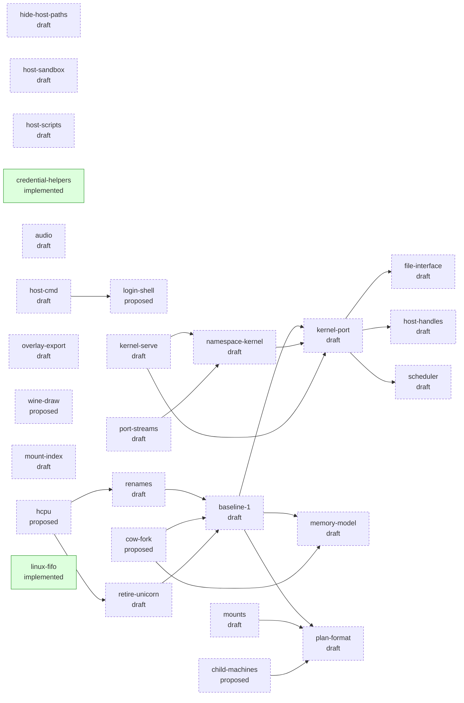

<!-- Generated by `zig build design -- status` on main after each merge. Don't edit it, or commit it in a PR. -->

# Proposal status

Every proposal at the top of [design/](README.md), in the order they were written, with its issue, its status, and whether it's ready, in progress, stalled, or what it needs. The proposals archived in each epoch's folder follow the graph. `zig build design -- list` prints all of them from any checkout.

| Proposal | Issue | Status | State | Title |
| --- | --- | --- | --- | --- |
| [hide-host-paths](hide-host-paths.md) |  | draft |  | Hide host paths in /proc/n/ns |
| [host-sandbox](host-sandbox.md) |  | draft |  | Host self-sandboxing |
| [host-scripts](host-scripts.md) |  | draft |  | Running host scripts as the program |
| [credential-helpers](credential-helpers.md) | [#119](../../../issues/119) | implemented |  | Credential helpers for WebSocket 9P |
| [audio](audio.md) |  | draft |  | Audio (--audio) |
| [host-cmd](host-cmd.md) |  | draft | in progress on host-cmd | Rethinking host commands |
| [overlay-export](overlay-export.md) |  | draft |  | Exporting a run's overlay changes |
| [login-shell](login-shell.md) | [#89](../../../issues/89) | proposed | needs host-cmd | h9 as a login shell |
| [child-machines](child-machines.md) | [#109](../../../issues/109) | proposed |  | Child machines |
| [cow-fork](cow-fork.md) | [#121](../../../issues/121) | proposed | in progress on cow-fork; in progress on claude/project-thread-ipnqzx | Copy-on-write fork and demand-loaded file pages for Linux processes |
| [wine-draw](wine-draw.md) | [#158](../../../issues/158) | proposed | in progress on wine-draw | Wine windows through draw |
| [mount-index](mount-index.md) |  | draft | in progress on mount-index | Metadata indexes for 9P roots and mounts |
| [hcpu](hcpu.md) | [#174](../../../issues/174) | proposed |  | hcpu, h9's own CPUs for the emulator |
| [kernel-serve](kernel-serve.md) |  | draft |  | A 9P server in the kernel |
| [namespace-kernel](namespace-kernel.md) |  | draft | needs kernel-serve, port-streams | A namespace-only kernel build |
| [port-streams](port-streams.md) |  | draft |  | 9P over a MessagePort |
| [linux-fifo](linux-fifo.md) |  | implemented |  | Linux named pipes |
| [mounts](mounts.md) |  | draft |  | Mounts, binds, and a Plan 9 root |
| [baseline-1](baseline-1.md) |  | draft | needs renames, cow-fork, retire-unicorn | Baseline 1 (h9 at the end of epoch 0) |
| [file-interface](file-interface.md) |  | draft | needs kernel-port | A wider file interface inside the kernel, with 9P2000 as a view |
| [host-handles](host-handles.md) |  | draft | needs kernel-port | Host access through handles |
| [kernel-port](kernel-port.md) |  | draft | needs baseline-1, namespace-kernel, kernel-serve | Port the kernel core to Zig, as an instance |
| [memory-model](memory-model.md) |  | draft | needs baseline-1, cow-fork | One memory model under both ABIs |
| [plan-format](plan-format.md) |  | draft | needs baseline-1, mounts, child-machines | The plan as a file, and the one way in |
| [renames](renames.md) |  | draft | needs hcpu | Rename the parts, to ABI, engine, sud, and hcpu |
| [retire-unicorn](retire-unicorn.md) |  | draft | needs hcpu | Retire Unicorn as an engine |
| [scheduler](scheduler.md) |  | draft | needs kernel-port | A scheduler, with processes on per-core executors |

## Epoch 0

Archived in [epoch-0/](epoch-0/).

| Proposal | Issue | Status | Title |
| --- | --- | --- | --- |
| [proposals](epoch-0/proposals.md) | [#1](../../../issues/1) | implemented | Proposals replace milestones and the design changelog |
| [semaphores](epoch-0/semaphores.md) | [#3](../../../issues/3) | implemented | rendezvous and semaphores |
| [segattach](epoch-0/segattach.md) | [#4](../../../issues/4) | implemented | segattach and shared segments |
| [net-policy](epoch-0/net-policy.md) | [#5](../../../issues/5) | implemented | Outbound-only network by default, and --net-allow |
| [ephemeral-writes](epoch-0/ephemeral-writes.md) | [#6](../../../issues/6) | implemented | Ephemeral writes and a private /tmp |
| [go-compat](epoch-0/go-compat.md) | [#7](../../../issues/7) | implemented | Go compatibility |
| [devsrv](epoch-0/devsrv.md) | [#8](../../../issues/8) | implemented | devsrv, /srv, and mount |
| [self-host](epoch-0/self-host.md) | [#10](../../../issues/10) | implemented | Self-hosting |
| [overlay](epoch-0/overlay.md) | [#11](../../../issues/11) | implemented | Copy-on-write overlay as the root's default |
| [ninep-roots](epoch-0/ninep-roots.md) | [#13](../../../issues/13) | implemented | 9P roots |
| [image-roots](epoch-0/image-roots.md) | [#14](../../../issues/14) | declined | Disk-image roots |
| [gfx](epoch-0/gfx.md) | [#15](../../../issues/15) | implemented | Graphics (--gfx) |
| [kvm](epoch-0/kvm.md) | [#16](../../../issues/16) | implemented | KVM backend |
| [whp](epoch-0/whp.md) | [#17](../../../issues/17) | implemented | WHP backend |
| [zig-interpreter](epoch-0/zig-interpreter.md) | [#19](../../../issues/19) | superseded | A native Zig interpreter for the emulator |
| [baseline](epoch-0/baseline.md) |  | implemented | Baseline (h9 before proposals) |
| [i386](epoch-0/i386.md) | [#9](../../../issues/9) | implemented | 386 binaries |
| [browser-host](epoch-0/browser-host.md) | [#12](../../../issues/12) | implemented | A browser host on wasm, with v86 |
| [linux-personality](epoch-0/linux-personality.md) | [#18](../../../issues/18) | implemented | Linux personality |
| [websocket-9p](epoch-0/websocket-9p.md) | [#21](../../../issues/21) | implemented | 9P over WebSocket |
| [dotl](epoch-0/dotl.md) | [#22](../../../issues/22) | implemented | 9P2000.L and ZeroFS |
| [exit-status](epoch-0/exit-status.md) | [#33](../../../issues/33) | implemented | Host exit statuses for processes killed by notes |
| [symlinks-in-root](epoch-0/symlinks-in-root.md) | [#34](../../../issues/34) | implemented | Symlinks resolved inside a bound tree |
| [linux-threads](epoch-0/linux-threads.md) | [#49](../../../issues/49) | implemented | Linux threads |
| [linux-net](epoch-0/linux-net.md) | [#50](../../../issues/50) | implemented | Linux readiness and sockets |
| [host-binfmt](epoch-0/host-binfmt.md) |  | declined | Running 9front binaries directly on Linux with binfmt_misc |
| [guest-tools](epoch-0/guest-tools.md) | [#32](../../../issues/32) | implemented | h9's own commands in the guest |
| [serve](epoch-0/serve.md) | [#35](../../../issues/35) | implemented | Serving the namespace over 9P |
| [multicall](epoch-0/multicall.md) | [#64](../../../issues/64) | implemented | A multi-call 9front userland binary |
| [builtin-root](epoch-0/builtin-root.md) | [#87](../../../issues/87) | implemented | A built-in root |
| [host-srv](epoch-0/host-srv.md) |  | superseded | Posting host connections to /srv |
| [root-auth](epoch-0/root-auth.md) |  | declined | Authenticated 9P roots |
| [default-command](epoch-0/default-command.md) | [#81](../../../issues/81) | implemented | A default command from the root |
| [browser-gfx](epoch-0/browser-gfx.md) | [#120](../../../issues/120) | implemented | Graphics on the browser host |
| [schemeless-roots](epoch-0/schemeless-roots.md) | [#76](../../../issues/76) | implemented | Schemeless roots |
| [native-backend](epoch-0/native-backend.md) | [#95](../../../issues/95) | implemented | Native backend |
| [recursive-unions](epoch-0/recursive-unions.md) | [#102](../../../issues/102) | superseded | Recursive unions and root layers |
| [linux-i386](epoch-0/linux-i386.md) | [#105](../../../issues/105) | implemented | 32-bit x86 Linux programs |
| [tilde-roots](epoch-0/tilde-roots.md) | [#107](../../../issues/107) | declined | Tilde roots from $H9ROOTPATH |
| [proposal-flow](epoch-0/proposal-flow.md) |  | implemented | A proposal lifecycle for building first, branches, Done criteria, and easier signing |
| [linux-pty](epoch-0/linux-pty.md) |  | implemented | Linux pseudoterminals |
| [epochs](epoch-0/epochs.md) |  | implemented | Epochs, and archiving closed proposals |
| [spec-split](epoch-0/spec-split.md) |  | implemented | Splitting SPEC.md into files under spec/ |
