<!-- Generated by `zig build design -- status` on main after each merge. Don't edit it, or commit it in a PR. -->

# Proposal status

Every proposal under [design/](README.md), in the order they were written, with its issue, its status, and whether it's ready, in progress, stalled, or what it needs. `zig build design -- list` prints the same from any checkout.

| Proposal | Issue | Status | State | Title |
| --- | --- | --- | --- | --- |
| [proposals](proposals.md) | [#1](../../../issues/1) | implemented |  | Proposals replace milestones and the design changelog |
| [semaphores](semaphores.md) | [#3](../../../issues/3) | implemented |  | rendezvous and semaphores |
| [segattach](segattach.md) | [#4](../../../issues/4) | implemented |  | segattach and shared segments |
| [net-policy](net-policy.md) | [#5](../../../issues/5) | implemented |  | Outbound-only network by default, and --net-allow |
| [ephemeral-writes](ephemeral-writes.md) | [#6](../../../issues/6) | implemented |  | Ephemeral writes and a private /tmp |
| [go-compat](go-compat.md) | [#7](../../../issues/7) | implemented |  | Go compatibility |
| [devsrv](devsrv.md) | [#8](../../../issues/8) | implemented |  | devsrv, /srv, and mount |
| [self-host](self-host.md) | [#10](../../../issues/10) | implemented |  | Self-hosting |
| [overlay](overlay.md) | [#11](../../../issues/11) | implemented |  | Copy-on-write overlay as the root's default |
| [9p-roots](9p-roots.md) | [#13](../../../issues/13) | implemented |  | 9P roots |
| [image-roots](image-roots.md) | [#14](../../../issues/14) | declined |  | Disk-image roots |
| [gfx](gfx.md) | [#15](../../../issues/15) | implemented |  | Graphics (--gfx) |
| [kvm](kvm.md) | [#16](../../../issues/16) | implemented |  | KVM backend |
| [whp](whp.md) | [#17](../../../issues/17) | implemented |  | WHP backend |
| [zig-interpreter](zig-interpreter.md) | [#19](../../../issues/19) | proposed |  | A native Zig interpreter for the emulator |
| [baseline](baseline.md) |  | implemented |  | Baseline (h9 before proposals) |
| [ci](ci.md) |  | draft |  | Continuous integration |
| [hide-host-paths](hide-host-paths.md) |  | draft |  | Hide host paths in /proc/n/ns |
| [host-sandbox](host-sandbox.md) |  | draft |  | Host self-sandboxing |
| [i386](i386.md) | [#9](../../../issues/9) | implemented |  | 386 binaries |
| [browser-host](browser-host.md) | [#12](../../../issues/12) | implemented |  | A browser host on wasm, with v86 |
| [linux-personality](linux-personality.md) | [#18](../../../issues/18) | implemented |  | Linux personality |
| [websocket-9p](websocket-9p.md) | [#21](../../../issues/21) | implemented |  | 9P over WebSocket |
| [dotl](dotl.md) | [#22](../../../issues/22) | accepted | ready | 9P2000.L and ZeroFS |
| [exit-status](exit-status.md) | [#33](../../../issues/33) | implemented |  | Host exit statuses for processes killed by notes |
| [symlinks-in-root](symlinks-in-root.md) | [#34](../../../issues/34) | implemented |  | Symlinks resolved inside a bound tree |
| [linux-threads](linux-threads.md) | [#49](../../../issues/49) | implemented |  | Linux threads |
| [linux-net](linux-net.md) | [#50](../../../issues/50) | implemented |  | Linux readiness and sockets |
| [host-binfmt](host-binfmt.md) |  | draft |  | Running 9front binaries directly on Linux with binfmt_misc |
| [guest-tools](guest-tools.md) | [#32](../../../issues/32) | implemented |  | h9's own commands in the guest |
| [serve](serve.md) | [#35](../../../issues/35) | implemented |  | Serving the namespace over 9P |
| [multicall](multicall.md) | [#64](../../../issues/64) | implemented |  | A multi-call 9front userland binary |
| [builtin-root](builtin-root.md) | [#87](../../../issues/87) | implemented |  | A built-in root |
| [host-scripts](host-scripts.md) |  | draft |  | Running host scripts as the program |
| [host-srv](host-srv.md) |  | draft |  | Posting host connections to /srv |
| [root-auth](root-auth.md) |  | draft |  | Authenticated 9P roots |
| [default-command](default-command.md) | [#81](../../../issues/81) | implemented |  | A default command from the root |
| [credential-helpers](credential-helpers.md) | [#119](../../../issues/119) | proposed | needs dotl | Credential helpers for WebSocket 9P |
| [browser-gfx](browser-gfx.md) | [#120](../../../issues/120) | implemented |  | Graphics on the browser host |
| [audio](audio.md) |  | draft |  | Audio (--audio) |
| [host-cmd](host-cmd.md) |  | draft |  | Rethinking host commands |
| [overlay-export](overlay-export.md) |  | draft |  | Exporting a run's overlay changes |
| [schemeless-roots](schemeless-roots.md) | [#76](../../../issues/76) | implemented |  | Schemeless roots |
| [login-shell](login-shell.md) | [#89](../../../issues/89) | proposed | needs host-cmd | h9 as a login shell |
| [native-backend](native-backend.md) | [#95](../../../issues/95) | implemented |  | Native backend |
| [recursive-unions](recursive-unions.md) | [#102](../../../issues/102) | proposed |  | Recursive unions and root layers |
| [linux-i386](linux-i386.md) | [#105](../../../issues/105) | implemented |  | 32-bit x86 Linux programs |
| [tilde-roots](tilde-roots.md) | [#107](../../../issues/107) | proposed |  | Tilde roots from $H9ROOTPATH |
| [child-machines](child-machines.md) | [#109](../../../issues/109) | proposed |  | Child machines |
| [cow-fork](cow-fork.md) | [#121](../../../issues/121) | proposed |  | Copy-on-write fork and demand-loaded file pages for Linux processes |
| [wine-draw](wine-draw.md) | [#158](../../../issues/158) | proposed |  | Wine windows through draw |
| [mount-index](mount-index.md) |  | draft |  | Metadata indexes for 9P roots and mounts |
| [hcpu](hcpu.md) | [#174](../../../issues/174) | proposed |  | hcpu, h9's own CPUs for the emulator |
| [proposal-flow](proposal-flow.md) |  | implemented |  | A proposal lifecycle for building first, branches, Done criteria, and easier signing |

```mermaid
flowchart LR
  classDef draft stroke-dasharray: 4 3
  classDef accepted stroke-width: 2px
  classDef implemented fill:#dfd,stroke:#393
  classDef closed fill:#eee,stroke:#999,color:#777
  p_proposals["proposals<br/>implemented"]:::implemented
  p_semaphores["semaphores<br/>implemented"]:::implemented
  p_segattach["segattach<br/>implemented"]:::implemented
  p_net_policy["net-policy<br/>implemented"]:::implemented
  p_ephemeral_writes["ephemeral-writes<br/>implemented"]:::implemented
  p_go_compat["go-compat<br/>implemented"]:::implemented
  p_devsrv["devsrv<br/>implemented"]:::implemented
  p_self_host["self-host<br/>implemented"]:::implemented
  p_overlay["overlay<br/>implemented"]:::implemented
  p_9p_roots["9p-roots<br/>implemented"]:::implemented
  p_image_roots["image-roots<br/>declined"]:::closed
  p_gfx["gfx<br/>implemented"]:::implemented
  p_kvm["kvm<br/>implemented"]:::implemented
  p_whp["whp<br/>implemented"]:::implemented
  p_zig_interpreter["zig-interpreter<br/>proposed"]:::draft
  p_baseline["baseline<br/>implemented"]:::implemented
  p_ci["ci<br/>draft"]:::draft
  p_hide_host_paths["hide-host-paths<br/>draft"]:::draft
  p_host_sandbox["host-sandbox<br/>draft"]:::draft
  p_i386["i386<br/>implemented"]:::implemented
  p_browser_host["browser-host<br/>implemented"]:::implemented
  p_linux_personality["linux-personality<br/>implemented"]:::implemented
  p_websocket_9p["websocket-9p<br/>implemented"]:::implemented
  p_dotl["dotl<br/>accepted"]:::accepted
  p_exit_status["exit-status<br/>implemented"]:::implemented
  p_symlinks_in_root["symlinks-in-root<br/>implemented"]:::implemented
  p_linux_threads["linux-threads<br/>implemented"]:::implemented
  p_linux_net["linux-net<br/>implemented"]:::implemented
  p_host_binfmt["host-binfmt<br/>draft"]:::draft
  p_guest_tools["guest-tools<br/>implemented"]:::implemented
  p_serve["serve<br/>implemented"]:::implemented
  p_multicall["multicall<br/>implemented"]:::implemented
  p_builtin_root["builtin-root<br/>implemented"]:::implemented
  p_host_scripts["host-scripts<br/>draft"]:::draft
  p_host_srv["host-srv<br/>draft"]:::draft
  p_root_auth["root-auth<br/>draft"]:::draft
  p_default_command["default-command<br/>implemented"]:::implemented
  p_credential_helpers["credential-helpers<br/>proposed"]:::draft
  p_browser_gfx["browser-gfx<br/>implemented"]:::implemented
  p_audio["audio<br/>draft"]:::draft
  p_host_cmd["host-cmd<br/>draft"]:::draft
  p_overlay_export["overlay-export<br/>draft"]:::draft
  p_schemeless_roots["schemeless-roots<br/>implemented"]:::implemented
  p_login_shell["login-shell<br/>proposed"]:::draft
  p_native_backend["native-backend<br/>implemented"]:::implemented
  p_recursive_unions["recursive-unions<br/>proposed"]:::draft
  p_linux_i386["linux-i386<br/>implemented"]:::implemented
  p_tilde_roots["tilde-roots<br/>proposed"]:::draft
  p_child_machines["child-machines<br/>proposed"]:::draft
  p_cow_fork["cow-fork<br/>proposed"]:::draft
  p_wine_draw["wine-draw<br/>proposed"]:::draft
  p_mount_index["mount-index<br/>draft"]:::draft
  p_hcpu["hcpu<br/>proposed"]:::draft
  p_proposal_flow["proposal-flow<br/>implemented"]:::implemented
  p_semaphores --> p_go_compat
  p_semaphores --> p_devsrv
  p_ephemeral_writes --> p_overlay
  p_semaphores --> p_9p_roots
  p_devsrv --> p_9p_roots
  p_devsrv --> p_image_roots
  p_9p_roots --> p_image_roots
  p_devsrv --> p_gfx
  p_kvm --> p_whp
  p_kvm --> p_host_sandbox
  p_whp --> p_host_sandbox
  p_go_compat --> p_browser_host
  p_i386 --> p_browser_host
  p_symlinks_in_root --> p_linux_personality
  p_exit_status --> p_linux_personality
  p_net_policy --> p_websocket_9p
  p_devsrv --> p_websocket_9p
  p_9p_roots --> p_websocket_9p
  p_guest_tools --> p_websocket_9p
  p_devsrv --> p_dotl
  p_9p_roots --> p_dotl
  p_serve --> p_dotl
  p_guest_tools --> p_dotl
  p_linux_personality --> p_linux_threads
  p_linux_net --> p_linux_threads
  p_linux_personality --> p_linux_net
  p_devsrv --> p_serve
  p_websocket_9p --> p_serve
  p_builtin_root --> p_serve
  p_multicall --> p_builtin_root
  p_devsrv --> p_host_srv
  p_9p_roots --> p_host_srv
  p_websocket_9p --> p_host_srv
  p_9p_roots --> p_root_auth
  p_websocket_9p --> p_credential_helpers
  p_dotl --> p_credential_helpers
  p_browser_host --> p_browser_gfx
  p_gfx --> p_browser_gfx
  p_browser_host --> p_audio
  p_ephemeral_writes --> p_overlay_export
  p_9p_roots --> p_schemeless_roots
  p_websocket_9p --> p_schemeless_roots
  p_default_command --> p_login_shell
  p_host_cmd --> p_login_shell
  p_overlay --> p_recursive_unions
  p_linux_personality --> p_recursive_unions
  p_linux_personality --> p_linux_i386
  p_linux_threads --> p_linux_i386
  p_linux_net --> p_linux_i386
  p_browser_host --> p_linux_i386
  p_9p_roots --> p_tilde_roots
  p_websocket_9p --> p_tilde_roots
  p_schemeless_roots --> p_tilde_roots
  p_linux_personality --> p_cow_fork
  p_linux_threads --> p_cow_fork
  p_gfx --> p_wine_draw
  p_linux_personality --> p_wine_draw
  p_9p_roots --> p_mount_index
  p_websocket_9p --> p_mount_index
  p_guest_tools --> p_mount_index
  p_proposals --> p_proposal_flow
```

