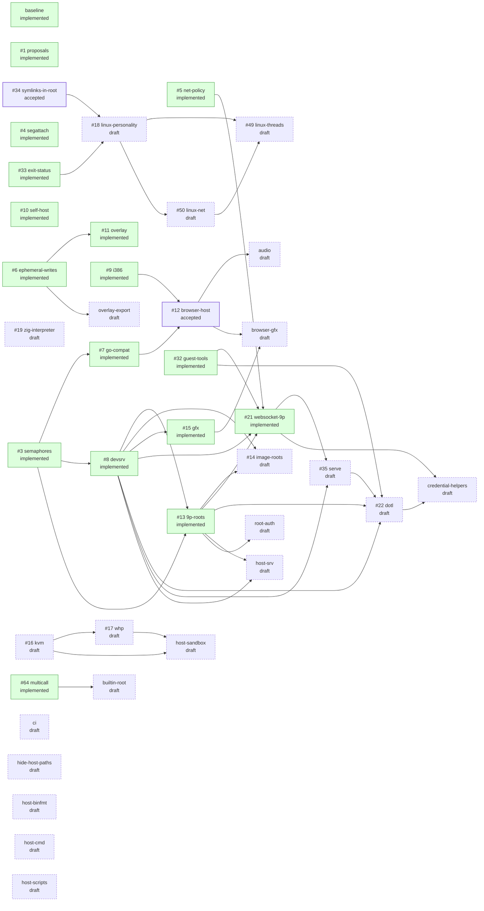

<!-- Generated by `zig build design -- status` on main after each merge. Don't edit it, or commit it in a PR. -->

# Proposal status

Every proposal under [design/](README.md), its status, and ready or what it needs. `zig build design -- list` prints the same from any checkout.

| Proposal | Status | State | Title |
| --- | --- | --- | --- |
| [baseline](0000-baseline.md) | implemented |  | Baseline (h9 before proposals) |
| [proposals](0001-proposals.md) | implemented |  | Proposals replace milestones and the design changelog |
| [semaphores](0003-semaphores.md) | implemented |  | rendezvous and semaphores |
| [segattach](0004-segattach.md) | implemented |  | segattach and shared segments |
| [net-policy](0005-net-policy.md) | implemented |  | Outbound-only network by default, and --net-allow |
| [ephemeral-writes](0006-ephemeral-writes.md) | implemented |  | Ephemeral writes and a private /tmp |
| [go-compat](0007-go-compat.md) | implemented |  | Go compatibility |
| [devsrv](0008-devsrv.md) | implemented |  | devsrv, /srv and mount |
| [i386](0009-i386.md) | implemented |  | 386 binaries |
| [self-host](0010-self-host.md) | implemented |  | Self-hosting |
| [overlay](0011-overlay.md) | implemented |  | Copy-on-write overlay as the root's default |
| [browser-host](0012-browser-host.md) | accepted | ready | A browser host on wasm, with v86 |
| [9p-roots](0013-9p-roots.md) | implemented |  | 9P roots |
| [image-roots](0014-image-roots.md) | draft |  | Disk-image roots |
| [gfx](0015-gfx.md) | implemented |  | Graphics (--gfx) |
| [kvm](0016-kvm.md) | draft |  | KVM backend |
| [whp](0017-whp.md) | draft | needs kvm | WHP backend |
| [linux-personality](0018-linux-personality.md) | draft | needs symlinks-in-root | Linux personality |
| [zig-interpreter](0019-zig-interpreter.md) | draft |  | A native Zig interpreter for the emulator |
| [websocket-9p](0021-websocket-9p.md) | implemented |  | 9P over WebSocket |
| [dotl](0022-dotl.md) | draft | needs serve | 9P2000.L and ZeroFS |
| [guest-tools](0032-guest-tools.md) | implemented |  | h9's own commands in the guest |
| [exit-status](0033-exit-status.md) | implemented |  | Host exit statuses for processes killed by notes |
| [symlinks-in-root](0034-symlinks-in-root.md) | accepted | ready | Symlinks resolved inside a bound tree |
| [serve](0035-serve.md) | draft |  | Serving the namespace over 9P |
| [linux-threads](0049-linux-threads.md) | draft | needs linux-personality, linux-net | Linux threads |
| [linux-net](0050-linux-net.md) | draft | needs linux-personality | Linux readiness and sockets |
| [multicall](0064-multicall.md) | implemented |  | A multi-call 9front userland binary |
| [audio](audio.md) | draft | needs browser-host | Audio (--audio) |
| [browser-gfx](browser-gfx.md) | draft | needs browser-host | Graphics on the browser host |
| [builtin-root](builtin-root.md) | draft |  | A built-in root |
| [ci](ci.md) | draft |  | Continuous integration |
| [credential-helpers](credential-helpers.md) | draft | needs dotl | Credential helpers for WebSocket 9P |
| [hide-host-paths](hide-host-paths.md) | draft |  | Hide host paths in /proc/n/ns |
| [host-binfmt](host-binfmt.md) | draft |  | Running 9front binaries directly on Linux with binfmt_misc |
| [host-cmd](host-cmd.md) | draft |  | Rethinking host commands |
| [host-sandbox](host-sandbox.md) | draft | needs kvm, whp | Host self-sandboxing |
| [host-scripts](host-scripts.md) | draft |  | Running host scripts as the program |
| [host-srv](host-srv.md) | draft |  | Posting host connections to /srv |
| [overlay-export](overlay-export.md) | draft |  | Exporting a run's overlay changes |
| [root-auth](root-auth.md) | draft |  | Authenticated 9P roots |

